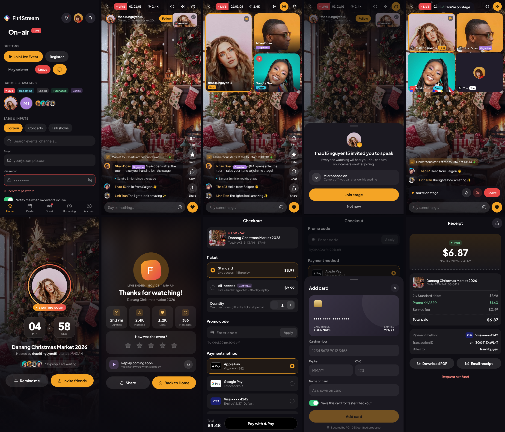

# @fit4stream/ui — React Native UI kit

> **VN:** Bộ component React Native (Expo + TypeScript) dựng lại từ prototype đã duyệt tại https://fit4stream.vercel.app.
> Gồm theme tokens (màu, font, spacing), bộ icon, ~60 component và 6 màn hình mẫu (Gallery, Live player, Waiting room, Live ended, Checkout, Receipt) để dev copy.



Dark theme · Plus Jakarta Sans · 44px tap targets · borderless icon buttons.

## 1. Install

```bash
npx expo install react-native-svg expo-linear-gradient expo-blur expo-haptics react-native-safe-area-context expo-font
npx expo install @expo-google-fonts/plus-jakarta-sans
```

Copy `src/` into your app (e.g. `src/ui/`) or add this folder as a workspace package (`"@fit4stream/ui": "file:./packages/fit4stream-ui"`).

Tested against React Native 0.76 / Expo SDK 52 with `tsc --strict`.

## 2. Bootstrap

```tsx
import { useFonts, PlusJakartaSans_400Regular, PlusJakartaSans_500Medium, PlusJakartaSans_600SemiBold,
  PlusJakartaSans_700Bold, PlusJakartaSans_800ExtraBold } from '@expo-google-fonts/plus-jakarta-sans';
import { SafeAreaProvider } from 'react-native-safe-area-context';
import { ToastProvider } from '@fit4stream/ui';

export default function App() {
  const [ok] = useFonts({ PlusJakartaSans_400Regular, PlusJakartaSans_500Medium, PlusJakartaSans_600SemiBold, PlusJakartaSans_700Bold, PlusJakartaSans_800ExtraBold });
  if (!ok) return null;
  return <SafeAreaProvider><ToastProvider>{/* navigation */}</ToastProvider></SafeAreaProvider>;
}
```

Font family names in `theme.fonts` match the keys above. Always render text through `<Text variant="…">` (kit) or `theme.type.*` so typography stays consistent.

## 3. What's inside

| Folder | Components |
|---|---|
| `theme/` | `colors`, `spacing`, `radius`, `fonts`, `type`, `shadow`, `motion`, `TAP` |
| `icons/` | `Icon` (57 line icons, 24px grid), `LogoMark`, `Logo` |
| `core/` | `PressableScale`, `Text`, `Button` (primary/secondary/ghost/live/danger/wallet), `IconButton` (chip/glass/plain), `Badge`, `RoleChip`, `Avatar` (ring: live/subtle), `AvatarStack`, `Card`, `Divider`, `Skeleton` |
| `form/` | `TextField`, `SearchField`, `SegmentedTabs`, `Stepper`, `RadioCard`, `RadioRow`, `RadioDot`, `Switch` |
| `feedback/` | `BottomSheet`, `ConfirmDialog`, `ToastProvider` / `useToast`, `EmptyState` |
| `navigation/` | `ScreenHeader`, `LargeTitle`, `SectionHeader`, `BottomNav` (Home · Guide · On-air · Upcoming · Account) |
| `event/` | `EventHeroCard` (Home coverflow), `EventRow`, `CategoryCard`, `DateStrip`, `GuideChannel`, `TimeRange`, `RatingSummary`, `Stars`, `ReviewCard`, `InfoRow`, `LiveBadge`, `LiveDot`, `Equalizer` |
| `live/` | `LiveStatusPill`, `ViewerPill`, `HostPill`, `PipTile`, `ActionRail`, `ChatOverlay`, `ChatOverlayLine`, `ChatBubble`, `ChatList`, `PinnedMessage`, `ChatComposer`, `ReactionTray`, `FloatingReaction`, `SpeakerTile`, `StageGrid`, `OnStageBar`, `HandRaisedBanner`, `InviteToStageSheet`, `WaitingRoom`, `LiveEnded`, `ReconnectingOverlay` |
| `payment/` | `PaymentLogo`, `CheckoutEventCard`, `TicketPicker`, `PromoCodeField`, `PaymentMethodList`, `OrderSummary`, `PayBar`, `SecureNote`, `AddCardSheet`, `CardPreview`, `ProcessingOverlay`, `PaymentDeclinedDialog`, `ReceiptHero`, `ReceiptItems`, `ReceiptMeta`, `RefundTimeline`, `RefundSheet`, `PaymentHistoryRow`, `StatusPill` |

## 4. Reference screens (`example/`)

`example/App.tsx` is a runnable demo (drop it into a blank Expo app as `App.tsx`, fix the import paths). Screens:

- **GalleryScreen** – every primitive on one page (living style guide).
- **LivePlayerScreen** – full-bleed player: event broadcast big, host cam in PiP (tap to swap), host pill + Follow at top, action rail, overlay chat, raise hand → invite → on stage, speakers grid, chat sheet (Chat / People / About), floating reactions.
- **WaitingRoomScreen** – pre-show lobby with countdown ring.
- **LiveEndedScreen** – stats, inline rating, replay notify.
- **CheckoutScreen** – ticket type + qty, promo (valid `XMAS20` / invalid), Apple Pay / Google Pay / saved cards / add card, summary, processing, declined (Mastercard •••• 8812 always declines in the demo).
- **ReceiptScreen** – receipt + refund request → pending timeline.

## 5. Integration notes for devs

- **Video**: every place that shows `<Image>` for a stream (`LivePlayerScreen` main view, `PipTile`, `SpeakerTile`) is a slot — swap in your player/track view (react-native-video, LiveKit `VideoTrack`, Agora, AWS IVS). `PipTile` accepts `children` for that.
- **Payments**: `AddCardSheet` is the visual spec. In production collect card data with your PSP's PCI-compliant inputs (e.g. Stripe `CardField` / PaymentSheet) — never send raw PAN through your own API. Apple Pay / Google Pay via the PSP SDK.
- **Chat legibility**: overlay chat lines must keep the dark translucent chip behind text (bright video frames).
- **Host pill** sits at the top of the player (not under the chat) so it can't be mistaken for a message.
- **Icon buttons**: borderless, solid `#25232C` chip. Don't put `BlurView` behind small round buttons on iOS (causes a seam line during transitions).
- **Organizer links** must open the profile of the tapped organizer (pass their id) — e.g. `GuideChannel.onOrganizer`.
- **Live card tap**: live + registered → open player directly; otherwise → event detail / checkout.
- Bottom sheets and dialogs render in a `Modal`, so they cover the tab bar.
- Animations use the native driver; haptics via `expo-haptics` (`haptic={false}` to disable per button).

## 6. Scripts

```bash
npm i -D typescript @types/react
npx tsc --noEmit   # strict typecheck (passes clean)
```
